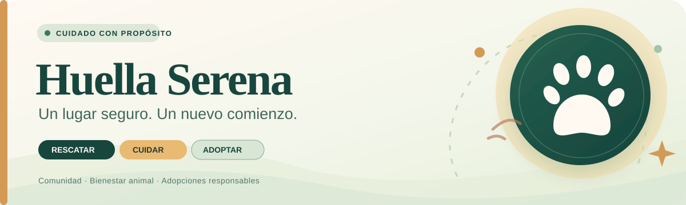

 

**Cuidar también es crear oportunidades.** 🐾

Una experiencia web para conectar **bienestar animal, adopciones responsables y ayuda comunitaria**.

 

 

<a href="#-descubre-huella-serena">Descubrir</a> ·
<a href="#-arranque-rápido">Instalar</a> ·
<a href="docs/RUTAS_Y_MODULOS.md">Rutas</a> ·
<a href="docs/progress/EJECUCION_V2.md">Progreso</a> ·
<a href="https://github.com/Developer-vic1/Refugio/issues">Participar</a>

---

## 🌿 Descubre Huella Serena

**Huella Serena** es una iniciativa en formación y una plataforma web para presentar animales, compartir historias y coordinar solicitudes de adopción, aportes y voluntariado. Un panel privado organiza su gestión.

| 🐶 **Explora** | 💚 **Colabora** | 🛡️ **Gestiona** |
| :---: | :---: | :---: |
| Catálogo, fichas e historias | Campañas, donaciones y voluntariado | Animales, solicitudes y publicaciones |
| [Ver rutas públicas](docs/RUTAS_Y_MODULOS.md) | [Ver módulos](docs/RUTAS_Y_MODULOS.md) | [Ver arquitectura](docs/ARQUITECTURA.md) |

<strong>🎨 Ver el estilo visual del proyecto</strong>

 

  
  
Imagen editorial generada para el diseño; no documenta un rescate real.

Diseño **Bosque y Hogar**, paleta cálida, animaciones accesibles, transiciones y modo de movimiento reducido. [Explorar el motor visual](docs/modules/MOTION_ENGINE.md).

## ⚡ Arranque rápido

<strong>🖥️ Laragon · Windows</strong>

1. Instala PHP **8.2+**, Composer, Node.js y MySQL; prepara la base existente **<code>refugio</code>** (22 tablas y 3 vistas).
2. Copia <code>.env.example</code> como <code>.env</code> y configura la conexión local.
3. En la carpeta del proyecto, ejecuta:

   \`\`\`powershell
   composer install
   npm install
   npm run build
   php start
   \`\`\`

También puedes abrir **<code>Iniciar Refugio.cmd</code>** en Windows. Si utilizas Apache de Laragon, apunta el VirtualHost a <code>public/</code>, nunca a la raíz.

<strong>🧩 ¿Cómo está organizado?</strong>

\`\`\`text
public/index.php → Router → Controller → Service/Repository → MySQL
                                ↓
                       Vista PHP + Tailwind + JS
\`\`\`

**Código:** <code>app/</code> · **Rutas:** <code>routes/</code> · **Estilos y movimiento:** <code>resources/</code> · **Archivos protegidos:** <code>storage/</code>.

[Arquitectura y carpetas](docs/ARQUITECTURA.md) · [Seguridad](docs/SEGURIDAD_Y_PUBLICACION.md)

## 🌱 Estado del proyecto

**V2 en consolidación.** El portal público, los componentes visuales y varias operaciones administrativas ya están implementados. **Aún no está listo para producción**: faltan procesos completos de adopción, inventario, finanzas, permisos y pruebas integrales.

Los animales, cifras y comprobantes deben verificarse antes de publicarse como información real.

🔀 **GitFlow:** <code>feature/*</code> → <code>develop</code> → <code>main</code> tras revisión.

  <a href="docs/progress/EJECUCION_V2.md"><strong>Ver avance de V2</strong></a> ·
  <a href="https://github.com/Developer-vic1/Refugio/pulls"><strong>Pull requests</strong></a> ·
  <a href="https://github.com/Developer-vic1/Refugio/issues/new"><strong>Proponer una mejora</strong></a>

  
Desarrollado con propósito por <a href="https://github.com/Developer-vic1">@Developer-vic1</a> · 🐾 Cada huella importa.

