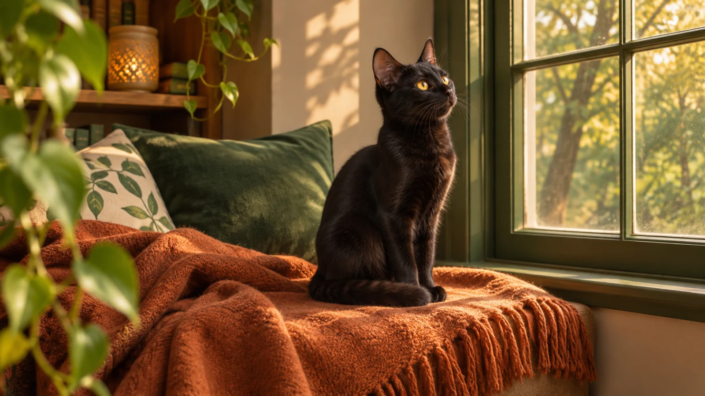

<div align="center">

<a href="docs/RUTAS_Y_MODULOS.md">
  
</a>

<br/>

<strong>Una plataforma para cuidar, conectar y abrir nuevas oportunidades. 🐾</strong>

<p>Adopciones responsables · Historias · Comunidad · Transparencia</p>

<p>
  <a href="#descubre">Descubre</a> &nbsp;·&nbsp;
  <a href="#experiencia">Experiencia</a> &nbsp;·&nbsp;
  <a href="#tecnologias">Tecnologías</a> &nbsp;·&nbsp;
  <a href="#comenzar">Comenzar</a> &nbsp;·&nbsp;
  <a href="#participa">Participa</a>
</p>

<p>
  <a href="https://github.com/Developer-vic1/Refugio/commits/main"></a>
  <a href="https://github.com/Developer-vic1/Refugio/pulls"></a>
  <a href="https://github.com/Developer-vic1/Refugio/stargazers"></a>
</p>

</div>

---

<a id="descubre"></a>
## 🌿 Descubre

**Huella Serena** es una iniciativa de bienestar animal en formación, acompañada de una plataforma web para compartir historias, encontrar posibles hogares y organizar la colaboración de la comunidad.

| 🐾 Explorar | 🤝 Colaborar | 🛡️ Administrar |
| :---: | :---: | :---: |
| Animales, fichas e historias | Campañas, donaciones y voluntariado | Solicitudes, contenido y operaciones |
| [Ver rutas públicas](docs/RUTAS_Y_MODULOS.md) | [Conocer los módulos](docs/RUTAS_Y_MODULOS.md) | [Explorar MVC](docs/ARQUITECTURA.md) |

<a id="experiencia"></a>
## ✨ Una experiencia con personalidad

<table>
<tr>
<td width="50%" align="center">
  
  <br><strong>Una bienvenida que conecta</strong>
  <br><sub>Diseño editorial, fotografía protagonista y navegación accesible.</sub>
</td>
<td width="50%" align="center">
  
  <br><strong>Cada historia importa</strong>
  <br><sub>Galerías, relatos, interacciones y movimiento consciente.</sub>
</td>
</tr>
</table>

<div align="center">
  <sub>Imágenes conceptuales creadas para la interfaz; no representan casos reales de rescate.</sub>
</div>

<details>
<summary><strong>🎨 Explorar el diseño y las animaciones</strong></summary>

La identidad visual combina **verde bosque, salvia, marfil y acentos miel**. Incluye un sistema de temas, tarjetas interactivas, transiciones y un motor de movimiento progresivo compatible con <code>prefers-reduced-motion</code>.

[Ver Hyperframes y movimiento](docs/modules/MOTION_ENGINE.md) · [Ver sistema UI](docs/modules/UI_FOUNDATION.md)

</details>

<a id="tecnologias"></a>
## 🧩 Tecnología que da vida al proyecto

<div align="center">


</div>

<details>
<summary><strong>🧭 Ver la arquitectura en 10 segundos</strong></summary>

```text
Navegador → public/index.php → Router → Controller
                                      ↓
                            Service / Repository
                                      ↓
                                  MySQL
                                      ↓
                          Vista PHP + Tailwind + JS
```

La carpeta <code>public/</code> es la única raíz web. <code>storage/</code> protege imágenes y documentos; <code>resources/</code> concentra los estilos y animaciones.

[Documentación de arquitectura](docs/ARQUITECTURA.md) · [Seguridad](docs/SEGURIDAD_Y_PUBLICACION.md)

</details>

<a id="comenzar"></a>
## 🚀 Comenzar

<details open>
<summary><strong>Instalación local · Laragon / Windows</strong></summary>

Necesitas **PHP 8.2+**, Composer, Node.js, MySQL y la base <code>refugio</code> ya creada (22 tablas y 3 vistas). Copia <code>.env.example</code> a <code>.env</code> y configura tu conexión.

```powershell
git clone https://github.com/Developer-vic1/Refugio.git
cd Refugio
Copy-Item .env.example .env
composer install
npm install
npm run build
php start
```

También puedes utilizar <code>Iniciar Refugio.cmd</code> en Windows. Para abrirlo con Apache de Laragon, configura el **DocumentRoot hacia <code>public/</code>**.

</details>

<a id="participa"></a>
## 💚 Construyamos mejores comienzos

**Estado:** V2 en consolidación. El sitio público y varios módulos administrativos están desarrollados; la formalización completa de adopciones, inventario, finanzas, permisos y validación integral siguen pendientes. **Todavía no es una plataforma lista para producción.**

<div align="center">

<a href="docs/progress/EJECUCION_V2.md"><strong>📍 Ver progreso</strong></a>
&nbsp;&nbsp;·&nbsp;&nbsp;
<a href="https://github.com/Developer-vic1/Refugio/issues/new"><strong>💡 Proponer mejora</strong></a>
&nbsp;&nbsp;·&nbsp;&nbsp;
<a href="https://github.com/Developer-vic1/Refugio/pulls"><strong>🔀 Pull requests</strong></a>

<p><sub>Ramas <code>feature/*</code> → <code>develop</code> → <code>main</code> · Sin datos personales, credenciales ni expedientes privados en Git.</sub></p>

<strong>Hecho con propósito por <a href="https://github.com/Developer-vic1">@Developer-vic1</a> 🌱</strong>

</div>
